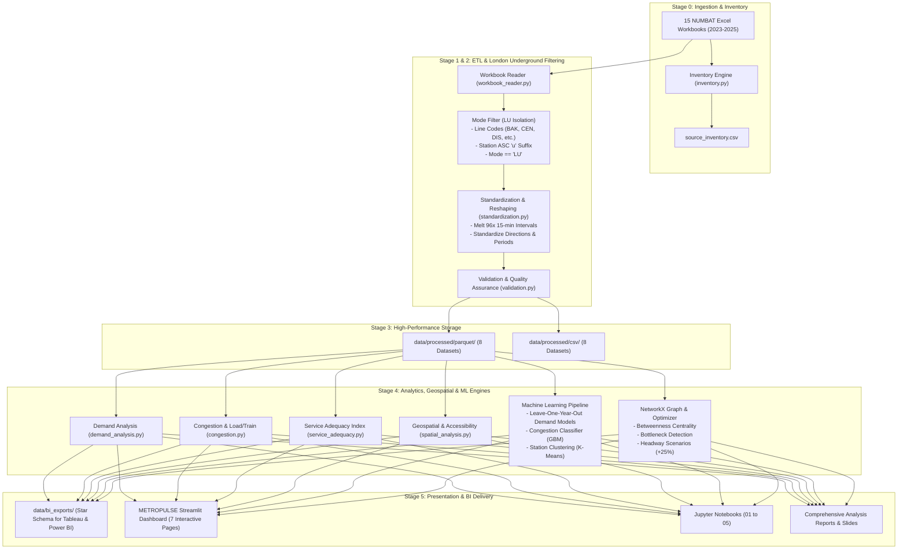

# METROPULSE — System Architecture

## Directory Hierarchy & Modules
- `src/config/`: System settings, line definitions, period maps, and data dictionary.
- `src/ingestion/`: Multi-workbook dynamic discovery, sheet inspection, and automated inventory.
- `src/preprocessing/`: London Underground filtering, wide-to-long interval melting, direction standardization, and validation checks.
- `src/analytics/`: System demand rankings, inflow/outflow asymmetry, load-per-train computation, and Service Adequacy Index.
- `src/geospatial/`: BNG (EPSG:27700) metric projection, distance to central London, and spatial coverage gap detection.
- `src/ml/`: Feature matrix construction, leave-one-year-out cross-validation, LightGBM/Random Forest regression, and K-Means clustering.
- `src/optimization/`: Directed graph construction, betweenness centrality, bottleneck isolation, and +25% headway relief modeling.
- `dashboard/`: Multi-page command-center Streamlit web application.
- `data/bi_exports/`: Star schema dimension and fact tables for enterprise BI software.

